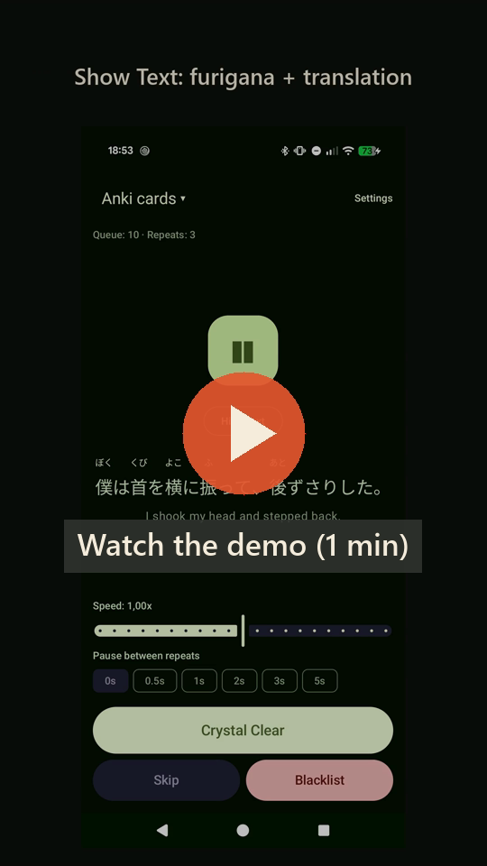

# Listening Practice

An Android app for Japanese listening practice built on your own Anki cards, videos and YouTube.
It plays only sentences made entirely of words you already know, loops the audio, and hides the
text until you ask for it — so you train your ear, not your reading.

## Demo

<!-- Served via jsDelivr: GitHub serves repo videos as raw bytes, jsDelivr as video/mp4 so browsers play them. -->
<a href="https://cdn.jsdelivr.net/gh/mattias/anki-listening-practice@main/docs/demo.mp4"></a>

One minute with sound: practicing Anki cards, the settings, downloading a YouTube video with
Japanese subtitles, and practicing it line by line.

## Features

- **Uses your Anki deck** — import an AnkiDroid export (`.apkg` deck or `.colpkg` collection).
  Both the default modern format and the "Support older Anki versions" format work.
- **Videos and audio with subtitles** — pick a video or audio file plus Japanese subtitles
  (`.srt`, `.vtt`, `.ass`). Each subtitle line is one sentence, played in order through the file.
  Furigana is generated automatically.
- **YouTube** — paste a link; the app checks for Japanese subtitles (manual first, then
  auto-generated), downloads just the audio and subtitles with
  [yt-dlp](https://github.com/yt-dlp/yt-dlp), and adds it like a local file.
- **Only fully known sentences** — sentences are split into words with
  [Kuromoji](https://github.com/atilika/kuromoji) and kept only if every word is known: in your
  [Jiten](https://jiten.moe) list or the target word (e.g. *Expression*) of one of your cards.
- **Looping audio** — adjustable speed (0.5x–1.5x) and pause between repeats (0–5 s).
- **Audio first** — text, furigana and translation stay hidden until you tap *Show Text*.
  Furigana is drawn above the kanji, from either Anki's `漢字[かんじ]` syntax or HTML `<ruby>`.
- **Queue of 10** — refills automatically when one sentence is left.
- **Three actions**
  - *Crystal Clear*: you understood it; the sentence rests for 10 days.
  - *Skip*: move it to the back of the queue.
  - *Blacklist*: never show it again.
- **Note type presets** for [Kiku](https://github.com/youyoumu/kiku),
  [Lapis](https://github.com/donkuri/lapis) and [Senren](https://github.com/BrenoAqua/Senren),
  with editable field mappings for anything else.
- **Small footprint** — after import only the sentence audio is kept; images, word audio and
  other media are deleted. Your AnkiDroid collection is never modified.

## Install

Download the latest `.apk` from
[Releases](https://github.com/mattias/anki-listening-practice/releases/latest) on your phone and
open it. Android will ask you to allow installing apps from your browser or file manager the first
time. Requires Android 8.0 or newer on a 64-bit ARM phone (practically every phone from the last
several years).

## Getting started

1. **Export from AnkiDroid**: export your mining deck as `.apkg` (or your whole collection as
   `.colpkg`) with *Include media* checked.
2. **Export known words from Jiten** as a `.txt` file with one word per line.
3. In the app, open **Settings** and:
   - tap **Import .apkg / .colpkg** and pick your export,
   - tap **Import known_words.txt** and pick your word list,
   - choose the preset matching your note type.
4. Go back and start listening.

Re-import your deck after adding cards. Removing an import in Settings deletes only the app's
copy.

### Videos, audio and YouTube

Under **Settings → Videos & audio**, either tap **Add video/audio + subtitles** and pick the
media file and then its subtitle file, or paste a **YouTube link** and tap **Download from
YouTube**. Then choose the video from the menu at the top of the practice screen. Sentences come
in the order they're spoken; ones with unknown words are skipped.

Picked files stay where they are, so don't move or delete them. YouTube downloads are stored in
the app. Downloading from YouTube is against YouTube's terms of service; use it for your own
study only.

### Field presets

| Preset | Note type contains | Sentence  | Furigana           | Translation           | Audio           | Word         |
|--------|--------------------|-----------|--------------------|-----------------------|-----------------|--------------|
| Kiku   | `Kiku`             | `Sentence`| `SentenceFurigana` | `SentenceTranslation` | `SentenceAudio` | `Expression` |
| Lapis  | `Lapis`            | `Sentence`| `SentenceFurigana` | —                     | `SentenceAudio` | `Expression` |
| Senren | `Senren`           | `sentence`| `sentenceFurigana` | `sentenceTranslation` | `sentenceAudio` | `word`       |

Field names match case-insensitively. Imports keep only audio referenced by each preset's
audio field, so if you point a preset at a different audio field, re-import your decks.

### How "known" is decided

Known words are your Jiten list plus the word field of every imported card. A word in a sentence
counts as known if its dictionary form, the form in the sentence, or its kana reading is among
them. Punctuation is ignored; particles are not, so they need to be in the list too.

## Building

Requirements: JDK 17 and the Android SDK (platform 35). Set `sdk.dir` in `local.properties`
or `ANDROID_HOME`.

```bash
./gradlew assembleDebug        # APK in app/build/outputs/apk/debug/
./gradlew testDebugUnitTest    # unit tests
./gradlew installDebug         # install on a connected device
```

Minimum Android version is 8.0 (API 26).

To build a signed release (`./gradlew assembleRelease`), create a git-ignored
`keystore.properties` in the project root with `storeFile`, `storePassword`, `keyAlias` and
`keyPassword`. Without it the release APK is left unsigned.

## Tech stack

Kotlin, Jetpack Compose (Material 3), Hilt, Coroutines/Flow, Media3 ExoPlayer, Room, DataStore,
Kuromoji (IPADIC), zstd-jni and [youtubedl-android](https://github.com/yausername/youtubedl-android)
(yt-dlp with Python and QuickJS).

## Project layout

```
app/src/main/java/dev/lovkvist/listening/
├── data/anki/       Anki package import (ApkgUnpacker), deck storage (DeckLibrary), presets, text cleanup
├── data/media/      Subtitle parsing, video/audio library, YouTube import
├── data/known/      Known-words list
├── data/local/      Room database for cool-downs and blacklist
├── data/settings/   DataStore settings
├── data/            SentenceRepository: filtering and queue supply
├── text/            Japanese tokenizer (Kuromoji)
├── playback/        Looping player with a pause between repeats
└── ui/              Compose screens and view models
```

## License

[GPL-3.0](LICENSE): use, modify and redistribute freely, including commercially, as long as
what you distribute is also GPL-3.0 with its source code available. The app is GPL because it
bundles youtubedl-android, which is GPL-3.0. Version 0.1.0 was released under MIT.
